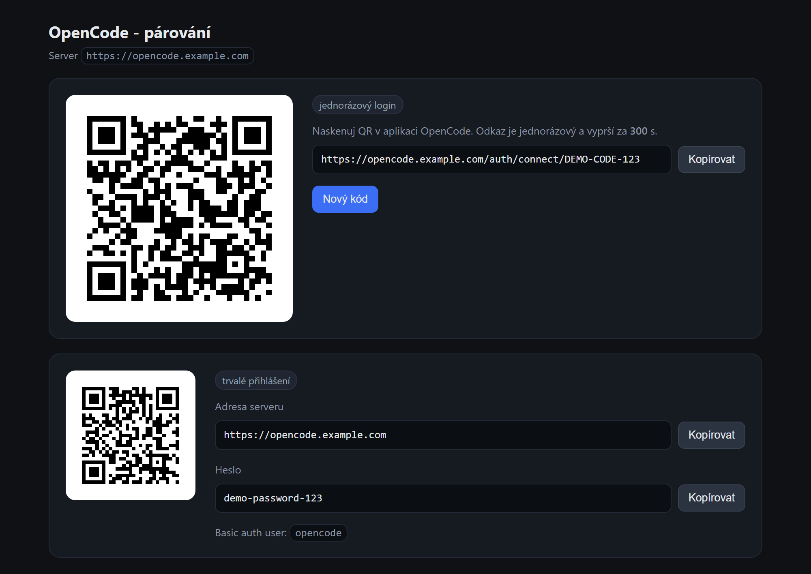

# opencode-pair

[](https://github.com/erikibolya/opencode-pair/actions/workflows/ci.yml)
[](https://github.com/erikibolya/opencode-pair/actions/workflows/codeql.yml)
[](https://erikibolya.github.io/opencode-pair/)
[](https://github.com/erikibolya/opencode-pair/pkgs/container/opencode-pair)
[](LICENSE)

A tiny web page that displays a **pairing QR code for a self-hosted [OpenCode](https://opencode.ai) server**, so you can pair the mobile/desktop app from a phone without touching a terminal.

`opencode pair` prints a QR code into the terminal, which is useless when the server runs in Docker on a headless box. This container wraps the same flow into a page you can open from any browser: it asks the running OpenCode server for a one-time pairing code, renders it as a QR code, and shows the permanent server address and password next to it.



**Live demo (static, fake data):** <https://erikibolya.github.io/opencode-pair/>

> Unofficial community tool. Not affiliated with Anomaly / the OpenCode project.

## Features

- Fresh one-time pairing code (QR + link) on every page, valid for 5 minutes
- Countdown, auto-refresh, and a **New code** button
- Permanent section with the server address, password and a QR code of the address
- Zero JavaScript dependencies, no database, no state on disk
- Single small image (`python:3.12-alpine`), runs as non-root with a healthcheck
- Hardened responses: strict CSP, `X-Frame-Options: DENY`, `nosniff`, `no-referrer`, `noindex`
- Optionally hides the password from the page (`HIDE_PASSWORD`), so only the QR code is shown
- Linted and type-checked in CI (ruff, mypy), CodeQL and Dependabot enabled

## Requirements

- An OpenCode **v2** server started with `opencode serve`, reachable from this container
- The server password (`OPENCODE_PASSWORD` on the server side). Basic auth user is always `opencode`.

## Quick start

```yaml
services:
  opencode-pair:
    image: ghcr.io/erikibolya/opencode-pair:latest
    container_name: opencode-pair
    restart: unless-stopped
    ports:
      - "8099:8080"
    environment:
      OPENCODE_API: http://opencode:4096
      OPENCODE_PUBLIC_URL: https://opencode.example.com
      OPENCODE_PASSWORD: ${OPENCODE_PASSWORD}
    networks:
      - opencode

networks:
  opencode:
    external: true
    name: traefik_network
```

```bash
cp compose.example.yaml compose.yaml
cp .env.example .env
# fill in OPENCODE_PASSWORD (and PAIR_AUTH if you enabled the basicauth middleware)
docker compose up -d
```

Then open <http://localhost:8099>.

Or without compose:

```bash
docker run -d --name opencode-pair -p 8099:8080 \
  -e OPENCODE_API=http://opencode:4096 \
  -e OPENCODE_PUBLIC_URL=https://opencode.example.com \
  -e OPENCODE_PASSWORD=your-server-password \
  ghcr.io/erikibolya/opencode-pair:latest
```

## Configuration

| Variable | Default | Description |
| --- | --- | --- |
| `OPENCODE_API` | `http://opencode:4096` | Base URL of the OpenCode server, as seen **from this container**. |
| `OPENCODE_PUBLIC_URL` | *(derived)* | Address of the OpenCode server used in the pairing links, e.g. `https://opencode.example.com`. When empty, the page derives it from the request (`X-Forwarded-Proto` / `X-Forwarded-Host` / `Host`). |
| `OPENCODE_PASSWORD` | *(empty)* | Password of the OpenCode server. Sent as HTTP Basic auth (user `opencode`). |
| `OPENCODE_USERNAME` | `opencode` | Basic auth user name, in case a fork changes it. |
| `PORT` | `8080` | Port the page listens on inside the container. |
| `PAGE_TITLE` | `OpenCode - párování` | Page heading. |
| `HIDE_PASSWORD` | *(off)* | Set to `1`/`true` to hide the server password on the page and show only the QR codes. |

## How it works

1. `POST {OPENCODE_API}/api/pair` with Basic auth → `{"code": "...", "expires_in": 300}`
2. The page builds `{OPENCODE_PUBLIC_URL}/auth/connect/{code}` and encodes it as an inline SVG QR code.
3. The app scans the QR (or the link is pasted into its server address field), redeems the one-time code and gets a session cookie that lasts 30 days.

Codes are single use and expire after 5 minutes; each page load asks for a fresh one and the page refreshes itself when the timer runs out.

## Security

**The page displays the OpenCode server password in plain text.** Anyone who can open the page can control the server (sessions, shell commands, files). Treat the page as a secret:

- keep it on a private network (LAN, VPN) or
- put it behind HTTP Basic auth / SSO. `compose.example.yaml` shows a Traefik `basicauth` middleware; generate the hash with `htpasswd -nbB user password` and put it in `.env` as `PAIR_AUTH`, escaping every `$` as `$$` (see `.env.example`).
- The pairing link itself is a bearer credential too - it is one-time and expires quickly, but do not post screenshots of it.

## Development

```bash
python -m venv .venv && . .venv/bin/activate
pip install -r app/requirements.txt
OPENCODE_API=http://127.0.0.1:4096 OPENCODE_PUBLIC_URL=http://localhost:8080 \
OPENCODE_PASSWORD=secret python app/main.py
```

Tests, lint and types (no extra runtime dependencies beyond `requirements.txt`):

```bash
python -m unittest discover -s tests -v
pip install ruff mypy
ruff check . && ruff format --check .
mypy
```

Rebuild the static demo used by GitHub Pages:

```bash
python scripts/build_demo.py _site
```

Build the image locally:

```bash
docker build -t opencode-pair .
```

## License

[MIT](LICENSE)
